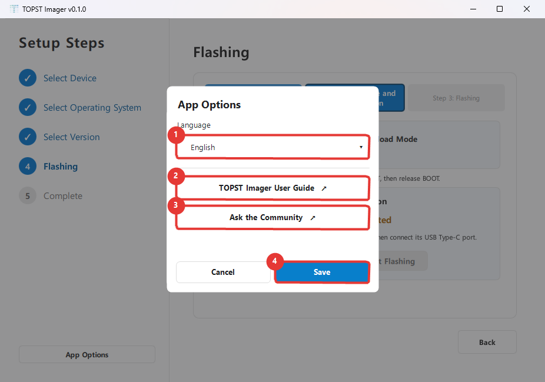
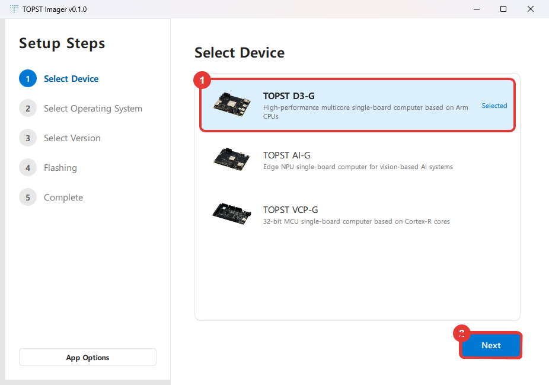
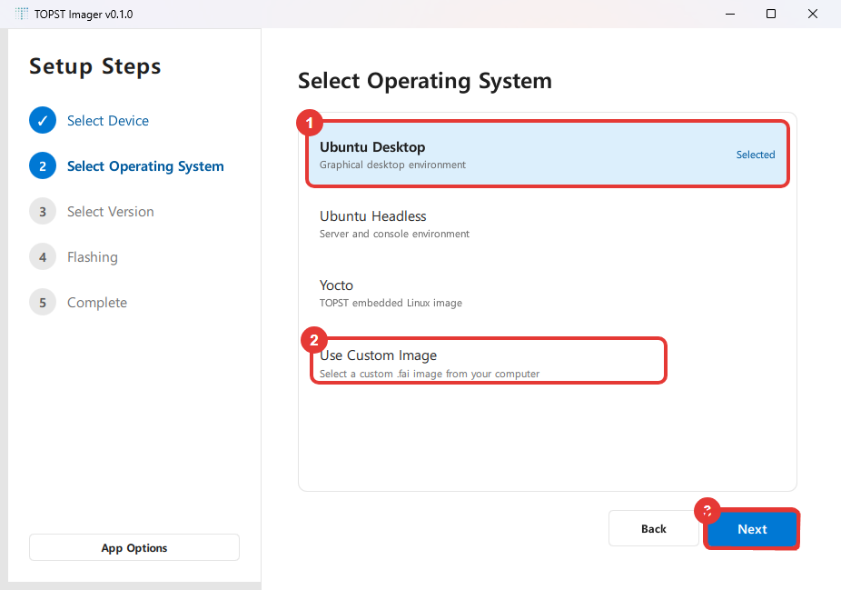
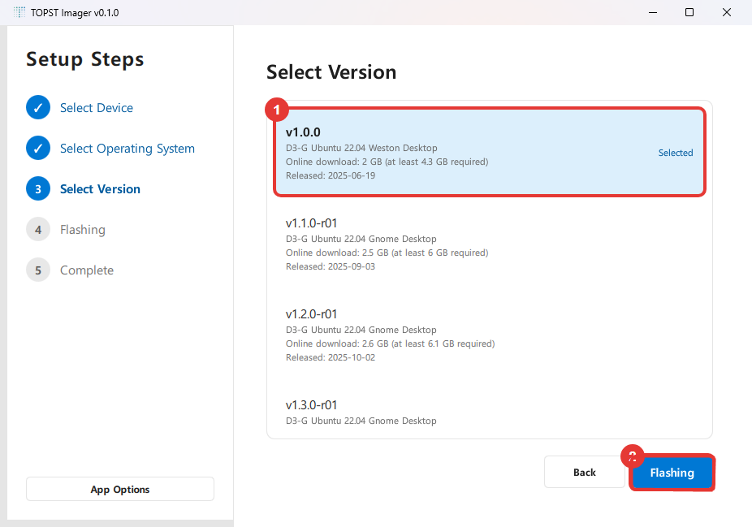
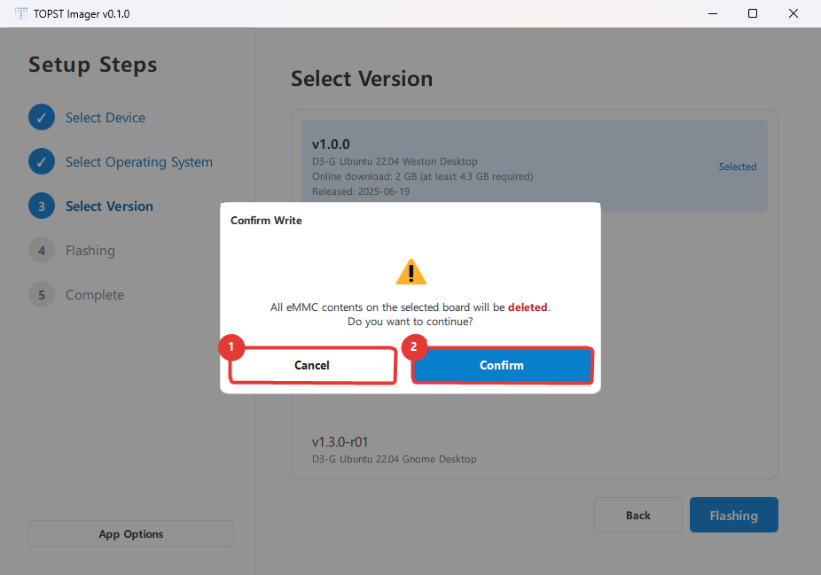
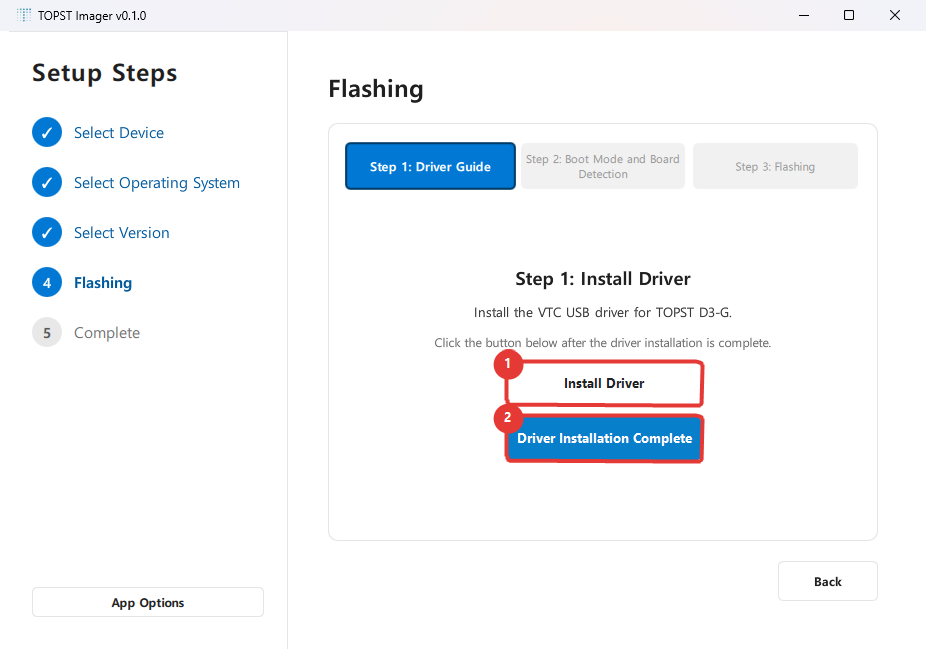
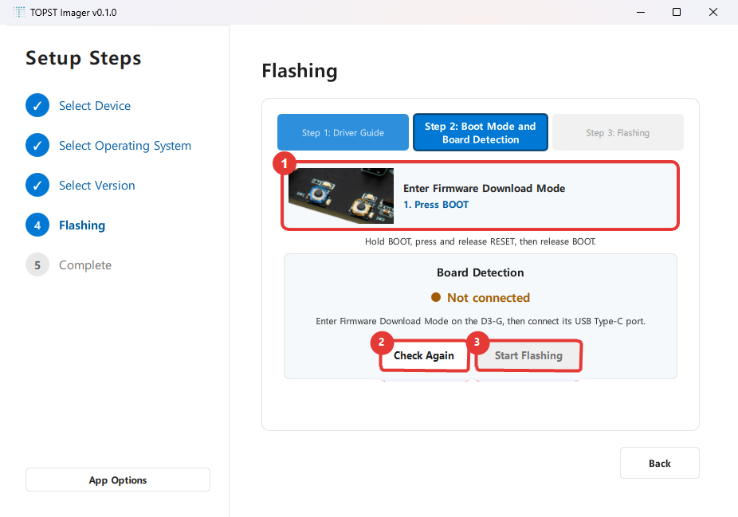

# TOPST Imager Benutzerhandbuch

TOPST Imager installiert ein Betriebssystem oder eine Firmware auf einem TOPST-Board.
Sie benötigen keine besonderen Computer- oder Elektronikkenntnisse. Folgen Sie dieser Anleitung und den Hinweisen in der Anwendung langsam Schritt für Schritt.

> **Wichtig:** Beim Flashen können alle Daten im eMMC des Boards gelöscht werden. Sichern Sie vor dem Start alle benötigten Dateien.

## 1. Hilfreiche Begriffe

| Begriff in der Anwendung | Einfache Erklärung |
| --- | --- |
| Board | Das TOPST-Gerät, auf dem Sie das Betriebssystem installieren. |
| Image | Die Betriebssystemdatei, die auf dem Board installiert wird. |
| Flashing | Das Schreiben einer Image-Datei auf das Board. |
| Boot mode | Ein besonderer Zustand, in dem der Computer ein Image auf dem Board installieren kann. |
| FWDN | Das interne Werkzeug zum Installieren von Images. Sie müssen es nicht selbst starten. |
| COM port | Der Name, mit dem der Computer ein über USB angeschlossenes Board erkennt. |
| eMMC | Der eingebaute Speicher des Boards. |

## 2. Unterstützte Boards und Image-Dateien

| Board | Eigenes Image-Format | Erforderliche Verbindung |
| --- | --- | --- |
| TOPST D3-G | `.fai` | FWDN-USB-Type-C-Datenkabel |
| TOPST AI-G | `.fai` | FWDN-USB-Type-C-Datenkabel und Ethernet-Kabel |
| TOPST VCP-G | `.rom` | FWDN-USB-Type-C-Datenkabel |

> Ein reines Ladekabel funktioniert nicht. Verwenden Sie ein **USB-Type-C-Kabel mit Datenübertragung**.

## 3. Vor dem Start

Halten Sie Folgendes bereit:

- Das TOPST-Board und sein Netzteil
- Ein USB-Type-C-Kabel mit Datenübertragung
- Einen Computer mit Internetverbindung
- Für AI-G ein Ethernet-Kabel
- Genügend freien Speicher zum Herunterladen und Entpacken des offiziellen Images
- Eine Sicherung wichtiger Daten auf dem Board

Schalten Sie während des Flashens das Board nicht aus und trennen Sie weder USB noch Ethernet. Schließen Sie TOPST Imager nicht. Schalten Sie den Computer nicht aus und lassen Sie ihn nicht in den Energiesparmodus wechseln.

## 4. Grundlegender Ablauf

Der grundlegende Ablauf ist unter Windows und Linux gleich.

1. Starten Sie TOPST Imager.
2. Wählen Sie das Board.
3. Wählen Sie ein Betriebssystem oder **Custom Image**.
4. Wählen Sie die zu installierende Version.
5. Befolgen Sie die Anschluss- und Bootmodus-Hinweise der Anwendung.
6. Starten Sie das Flashen.
7. Warten Sie auf den Bildschirm **Complete**.

Klicken Sie ein Element einmal an und wählen Sie **Next**, oder doppelklicken Sie auf das Element, um weiterzugehen.

---

# Anleitung für Windows

## 1. TOPST Imager unter Windows installieren

### 1.1 Unterstützte Systeme

- Windows 10, 64 Bit, oder neuer
- Windows 11, 64 Bit

### 1.2 Anwendung installieren

1. Laden Sie die Windows-Datei `TOPST Imager.exe` von der offiziellen TOPST-Website herunter.
2. Doppelklicken Sie auf die heruntergeladene Datei.
3. Lesen und akzeptieren Sie die Lizenzvereinbarung.
4. Wählen Sie bei Bedarf die Desktop-Verknüpfung.
5. Wählen Sie **Install**.
6. Wählen Sie nach Abschluss **Launch TOPST Imager** und beenden Sie das Setup.

Zeigt Windows eine Schutzmeldung an, prüfen Sie zuerst, ob die Datei von der offiziellen TOPST-Website stammt. Führen Sie sie nicht aus, wenn Sie die Quelle nicht bestätigen können.

Standardmäßiger Installationspfad:

```text
%LOCALAPPDATA%\Programs\TOPST Imager
```

## 2. Sprache und Darstellung

1. Wählen Sie unten links **App Options**.
2. Wählen Sie die gewünschte Sprache.
3. Wählen Sie **Save**.

> Die roten Rahmen und Zahlen in den Bildschirmaufnahmen wurden für diese Anleitung ergänzt. In der Anwendung erscheinen sie nicht.



1. **Language:** Gewünschte Sprache auswählen.
2. **Ask the Community:** Bei Fragen die TOPST-Community öffnen.
3. **Save:** Sprachauswahl anwenden.

Die Anwendung unterstützt Koreanisch, Englisch, Japanisch, vereinfachtes und traditionelles Chinesisch, Thai und Deutsch. Die helle oder dunkle Darstellung folgt automatisch dem Windows-Systemdesign.

## 3. Ein offizielles Image installieren

### 3.1 Board auswählen

1. Prüfen Sie Bild und Namen des Boards.
2. Klicken Sie einmal auf das gewünschte Board.
3. Prüfen Sie, ob sich die Farbe des ausgewählten Elements ändert.
4. Wählen Sie **Next**.



1. Wählen Sie den gewünschten **Board-Eintrag**.
2. Prüfen Sie die Auswahl und wählen Sie **Next**.

Bei einer falschen Auswahl kehren Sie mit **Back** zurück.

### 3.2 Betriebssystem und Version auswählen

1. Wählen Sie das Betriebssystem und anschließend **Next**.
2. Wählen Sie die zu installierende Version.
3. Prüfen Sie Veröffentlichungsdatum und Dateigrößen.



1. Für ein offizielles Image wählen Sie das gewünschte **Betriebssystem**.
2. Für eine lokale Datei wählen Sie **Use Custom Image**.
3. Prüfen Sie die Auswahl und wählen Sie **Next**.



1. Wählen Sie die **Version** und prüfen Sie Downloadgröße und Veröffentlichungsdatum.
2. Ist alles richtig, wählen Sie **Flashing**.

- **Download size:** Größe der komprimierten Datei aus dem Internet.
- **Extracted size:** Geschätzter Speicherbedarf nach dem Entpacken auf dem Computer.

Die neueste Version ist nicht immer erforderlich. Wählen Sie ohne andere Vorgaben die empfohlene oder die neueste stabile Version.

### 3.3 Löschwarnung bestätigen

Vor dem Flashen warnt TOPST Imager davor, dass der eMMC-Inhalt gelöscht werden kann.

1. Prüfen Sie Board und Image erneut.
2. Stellen Sie sicher, dass keine benötigten Daten mehr auf dem Board liegen.
3. Wählen Sie die Bestätigung, wenn Sie bereit sind.



1. Wählen Sie **Cancel**, wenn Sie noch nicht bereit sind oder die Auswahl prüfen möchten.
2. Wählen Sie **Confirm** erst, wenn Sie verstanden haben, dass der eMMC-Inhalt gelöscht werden kann.

Bei Unsicherheit wählen Sie **Cancel**. Ein Abbruch an dieser Stelle löscht das Board nicht.

## 4. D3-G flashen

### 4.1 Schritt 1: Treiber installieren

1. Wählen Sie **Install Driver**.
2. Fordert Windows Administratorrechte an, prüfen Sie die Meldung und wählen Sie **Yes**.
3. Führen Sie die VTC-Treiberinstallation vollständig durch.
4. Kehren Sie zu TOPST Imager zurück.
5. Wählen Sie **Driver Installation Complete**.



1. Starten Sie zuerst mit **Install Driver** das Installationsprogramm.
2. Schließen Sie alle Installationsschritte ab und wählen Sie dann **Driver Installation Complete**.

Normalerweise ist dies pro Computer nur einmal nötig.

### 4.2 Schritt 2: Bootmodus und Board-Erkennung

Beachten Sie das Board-Bild und die blinkenden Markierungen.

1. **Drücken Sie die BOOT-Taste.**
2. Halten Sie BOOT gedrückt.
3. **Drücken Sie RESET und lassen Sie RESET wieder los.**
4. Lassen Sie BOOT los.
5. Prüfen Sie den festen Sitz des USB-Type-C-Kabels am Computer und Board.
6. Prüfen Sie, ob die Anwendung das Board erkennt.



1. Folgen Sie der Bootmodus-Reihenfolge anhand des Bildes und der Markierungen.
2. Wählen Sie nach einer Anschlussänderung **Check Again**.
3. Nach erfolgreicher Erkennung wird **Continue Flashing** verfügbar.

Im Windows-Geräte-Manager kann das Board etwa als `Telechips TCCxxxx VTC USB Driver` erscheinen.

### 4.3 Schritt 3: Image flashen

1. Wählen Sie **Start Flashing**.
2. Beobachten Sie Download, Entpacken und Flashen.
3. Warten Sie auf den Abschlussbildschirm.

## 5. AI-G flashen

AI-G verwendet sowohl USB als auch Ethernet.

### 5.1 Schritt 1: Ethernet einrichten

1. Verbinden Sie Computer und AI-G mit einem Ethernet-Kabel.
2. Wählen Sie den mit AI-G verbundenen Ethernet-Adapter.
3. Stellen Sie die Computeradresse nach Anleitung auf `192.168.0.8/24` ein.
4. Bestätigen Sie den Abschluss der Netzwerkeinrichtung.

Wählen Sie den **kabelgebundenen Ethernet-Adapter für AI-G**, nicht den WLAN-Adapter.

### 5.2 Schritt 2: Bootmodus und COM-Port

1. Drücken Sie BOOT anhand der Animation.
2. Halten Sie BOOT gedrückt, drücken Sie RESET und lassen Sie RESET los.
3. Lassen Sie BOOT los.
4. Wählen Sie den neu erkannten USB-COM-Port von AI-G.
5. Prüfen Sie Stromversorgung, USB Type-C und Ethernet erneut.

Bei mehreren COM-Ports ziehen Sie das AI-G-USB-Kabel kurz ab. Der verschwundene Port gehört zu AI-G. Schließen Sie das Kabel wieder an und wiederholen Sie den Bootmodus, bevor Sie fortfahren.

### 5.3 Schritt 3: Image flashen

1. Wählen Sie **Start Flashing**.
2. Warten Sie bis 100 %.
3. Starten Sie das Board neu, nachdem der Abschlussbildschirm erscheint.

## 6. VCP-G flashen

### 6.1 Schritt 1: Bootmodus

1. Prüfen Sie das Board-Bild auf dem Bildschirm.
2. Halten Sie BOOT gedrückt.
3. Drücken Sie RESET und lassen Sie RESET los.
4. Lassen Sie BOOT los.
5. Wählen Sie **Next**.

### 6.2 Schritt 2: COM-Port auswählen

1. Wählen Sie den USB-COM-Port von VCP-G.
2. Fehlt der Port, verbinden Sie das USB-Type-C-Kabel erneut.
3. Aktualisieren Sie die Liste und wählen Sie den richtigen Port.

### 6.3 Schritt 3: Image flashen

1. Wählen Sie **Start Flashing**.
2. Warten Sie bis 100 %.
3. Starten Sie das Board nach Anzeige des Abschlussbildschirms neu.

## 7. Ein eigenes Image installieren

Verwenden Sie diese Option für eine lokale Datei außerhalb des offiziellen Katalogs.

1. Klicken Sie in der Betriebssystemauswahl einmal auf **Custom Image**.
2. Wählen Sie **Next** oder doppelklicken Sie auf den Eintrag.
3. Ziehen Sie die Datei in den gestrichelten Bereich oder wählen Sie sie über **Browse for FAI Image** bzw. **Browse for ROM Image** aus.
4. Prüfen Sie den Dateinamen.
5. Wählen Sie **Next** und folgen Sie den Anschlusshinweisen für Ihr Board.

Verwenden Sie `.fai` für D3-G und AI-G sowie `.rom` für VCP-G.
Da die Datei bereits lokal vorliegt, zeigt der Flash-Bildschirm keinen Download- oder Entpackschritt an.

## 8. Fehlerbehebung unter Windows

### Das Board wird nicht erkannt

1. Prüfen Sie die Stromversorgung.
2. Verwenden Sie kein reines USB-Ladekabel.
3. Prüfen Sie den Anschluss am FWDN-USB-Type-C-Port.
4. Wiederholen Sie den Bootmodus.
5. Prüfen Sie bei D3-G die Installation des VTC-Treibers.

### Kein COM-Port wird angezeigt

1. Trennen und verbinden Sie USB erneut.
2. Prüfen Sie die Stromversorgung.
3. Aktivieren Sie den Bootmodus erneut.
4. Aktualisieren Sie die COM-Port-Liste.

### AI-G zeigt einen Netzwerkfehler

1. Prüfen Sie das Ethernet-Kabel zwischen Computer und AI-G.
2. Prüfen Sie, ob der kabelgebundene Adapter statt WLAN gewählt wurde.
3. Prüfen Sie die Computeradresse `192.168.0.8/24`.
4. Beginnen Sie nach den Anwendungshinweisen wieder mit Schritt 1.

### `Failed open port` oder `GetLastError : 22`

Prüfen Sie das FWDN-USB-Type-C-Kabel, verbinden Sie es erneut und beginnen Sie wieder beim Bootmodus.

### Der Download schreitet nicht voran

1. Prüfen Sie die Internetverbindung.
2. Prüfen Sie den freien Speicher.
3. Warten Sie kurz und wählen Sie **Retry**.

### Während des Flashens zurückgehen

Nach Beginn erscheint beim Zurückgehen eine Abbruchbestätigung. Prüfen Sie vor dem Abbruch den sicheren Zustand des Boards und folgen Sie den Bildschirmhinweisen.

### Hilfe bei einem Fehler erhalten

1. Kopieren Sie die Details aus dem Fehlerfenster.
2. Öffnen Sie den Protokollordner über **App Options**.
3. Halten Sie Fehlermeldung und Protokolldatei bereit.
4. Fragen Sie in der [TOPST-Community](https://community.topst.ai/).

Üblicher Protokollpfad unter Windows:

```text
%LOCALAPPDATA%\Telechips\TOPST Imager\logs\topst-imager.log
```

---

# Anleitung für Linux

## 1. Vorbereitungen unter Linux

Bildschirme und Grundablauf sind wie unter Windows, einige Vorbereitungen unterscheiden sich jedoch. Die Schaltflächen für Board, Betriebssystem und Version stehen an denselben Stellen wie in den Windows-Bildern. Bei D3-G wird die Windows-Treiberseite übersprungen; die Anwendung geht direkt zum Bootmodus und zur Erkennung.

- Installieren Sie keinen Windows-VTC-Treiber.
- D3-G benötigt Linux-USB-Berechtigungen.
- AI-G und VCP-G benötigen Berechtigungen für serielle Ports.
- Das Paket muss Linux-FWDN-Programme enthalten.
- Zum Entpacken offizieller Images ist `unzip` oder `bsdtar` erforderlich.

Wenn Sie sich mit Befehlen nicht auskennen, bitten Sie einen Administrator oder Entwickler um die einmalige **Linux-Administratoreinrichtung** unten. Danach können normale Benutzer den Bildschirmhinweisen folgen.

## 2. Installation und Start unter Linux

Die Beispiele verwenden Ubuntu.

### 2.1 Paket entpacken

1. Laden Sie das passende Linux-Paket von der offiziellen TOPST-Website herunter.
2. Öffnen Sie den Downloads-Ordner.
3. Öffnen Sie ein Terminal und führen Sie Folgendes aus:

```bash
cd ~/Downloads
tar -xzf TOPST-Imager-<version>-Linux-<architecture>.tar.gz
```

Ersetzen Sie `<version>` und `<architecture>` durch die Werte des tatsächlichen Dateinamens. Mit dem Dateianfang und `Tab` können Sie den Namen vervollständigen.

### 2.2 Anwendung starten

Wechseln Sie in den entpackten Ordner und starten Sie die Anwendung:

```bash
cd TOPST-Imager-<version>-Linux-<architecture>
chmod +x topst-imager
./topst-imager
```

Fehlt laut Fehlermeldung eine `Qt`-Bibliothek, enthält das Paket keine Qt-Laufzeit. Normale Benutzer sollten beim Anbieter ein **Linux-Paket mit Qt-6.12-Laufzeit** anfordern, statt diese manuell zu installieren.

## 3. Linux-Administratoreinrichtung

Diese Schritte sind normalerweise nur einmal erforderlich.

### 3.1 Werkzeug zum Entpacken installieren

```bash
sudo apt update
sudo apt install unzip
```

### 3.2 Serielle Berechtigungen für AI-G und VCP-G

```bash
sudo usermod -aG dialout "$USER"
```

Melden Sie sich danach ab und wieder an oder starten Sie den Computer neu.

### 3.3 USB-Berechtigungen für D3-G

1. Verbinden Sie D3-G im Bootmodus.
2. Ermitteln Sie die USB-IDs im Terminal:

```bash
lsusb
```

3. Erstellen Sie `/etc/udev/rules.d/99-topst.rules` mit der erkannten Hersteller- und Produkt-ID.

```text
SUBSYSTEM=="usb", ATTR{idVendor}=="VENDOR_ID", ATTR{idProduct}=="PRODUCT_ID", MODE="0666"
```

4. Laden Sie die Regeln neu:

```bash
sudo udevadm control --reload-rules
sudo udevadm trigger
```

Tragen Sie keine beliebigen Werte für `VENDOR_ID` und `PRODUCT_ID` ein. Fragen Sie bei unbekannten D3-G-IDs den TOPST-Support.

### 3.4 Linux-FWDN-Dateien prüfen

Das Paket muss an diesen Stellen ausführbare Linux-Dateien ohne Dateiendung enthalten:

```text
tools/fwdn_d3/fwdn_d3
tools/fwdn_ai/fwdn_ai
tools/fwdn_vcp/fwdn_vcp
```

Sind sie vorhanden, erteilen Sie Ausführungsrechte:

```bash
chmod +x tools/fwdn_d3/fwdn_d3
chmod +x tools/fwdn_ai/fwdn_ai
chmod +x tools/fwdn_vcp/fwdn_vcp
```

Ohne diese Dateien kann Linux nicht flashen. Windows-`.exe`-Dateien sind kein Ersatz.

## 4. D3-G unter Linux flashen

Die Windows-VTC-Treiberinstallation entfällt.

1. Wählen Sie ein D3-G-Image.
2. Drücken Sie BOOT anhand der Animation.
3. Halten Sie BOOT gedrückt, drücken Sie RESET und lassen Sie RESET los.
4. Lassen Sie BOOT los.
5. Prüfen Sie die Board-Erkennung.
6. Starten Sie das Flashen und warten Sie auf den Abschluss.

Prüfen Sie bei fehlender Erkennung USB-Regel, Type-C-Kabel, Stromversorgung und Bootmodus.

## 5. AI-G unter Linux flashen

TOPST Imager ändert die Ethernet-Adresse unter Linux nicht automatisch. Richten Sie sie in den Ubuntu-Einstellungen manuell ein.

1. Öffnen Sie **Einstellungen → Netzwerk**.
2. Öffnen Sie die Einstellungen der kabelgebundenen AI-G-Verbindung.
3. Setzen Sie die IPv4-Methode auf **Manuell**.
4. Geben Sie `192.168.0.8` als Adresse ein.
5. Geben Sie `255.255.255.0` als Netzmaske ein, bei Präfixlänge `24`.
6. Lassen Sie Gateway und DNS ohne andere Vorgaben leer.
7. Übernehmen Sie die Einstellungen und schalten Sie die Kabelverbindung aus und wieder ein.
8. Kehren Sie zu TOPST Imager zurück und prüfen Sie den Ethernet-Status.
9. Aktivieren Sie den Bootmodus nach Bildschirmhinweisen.
10. Wählen Sie für AI-G `/dev/ttyUSB...` oder `/dev/ttyACM...`.
11. Starten Sie das Flashen.

## 6. VCP-G unter Linux flashen

1. Aktivieren Sie den Bootmodus nach Bildschirmhinweisen.
2. Wählen Sie einen Port im Format `/dev/ttyUSB...` oder `/dev/ttyACM...`.
3. Prüfen Sie den Port und starten Sie das Flashen.
4. Warten Sie auf den Abschlussbildschirm.

Fehlt der Port, prüfen Sie den Beitritt zur Gruppe `dialout` und die erneute Anmeldung.

## 7. Fehlerbehebung unter Linux

### `Permission denied`

- AI-G oder VCP-G: Prüfen Sie die Mitgliedschaft in `dialout`.
- D3-G: Prüfen Sie die aktive udev-USB-Regel.
- FWDN-Datei: Prüfen Sie die Ausführungsrechte durch `chmod +x`.

### Linux-FWDN-Datei nicht gefunden

Prüfen Sie das Linux-Programm unter `tools/fwdn_*` im Paketordner. Windows-`.exe`-Dateien laufen nicht unter Linux.

### Kein Board-Port wird angezeigt

Listen Sie die Ports mit diesem Befehl auf:

```bash
ls /dev/ttyUSB* /dev/ttyACM* 2>/dev/null
```

Vergleichen Sie die Liste vor und nach dem USB-Anschluss. Der neue Eintrag ist normalerweise der Board-Port.

### Helles oder dunkles Design wird nicht übernommen

TOPST Imager nutzt die vom Linux-Desktop über Qt bereitgestellten Theme-Informationen. Manche Umgebungen übernehmen Änderungen verzögert. Starten Sie die Anwendung neu.

## 8. Nach dem Flashen

1. Prüfen Sie die Erfolgsmeldung.
2. Warten Sie, bis TOPST Imager alle Arbeiten beendet hat.
3. Schalten Sie das Board sicher aus.
4. Entfernen Sie das FWDN-Kabel oder stellen Sie die Verkabelung für den normalen Betrieb her.
5. Schalten Sie das Board ein und prüfen Sie den Start des neuen Betriebssystems.

Offizielle Images werden in einen temporären Ordner geladen und entpackt. Nach erfolgreichem Flashen werden die heruntergeladenen Dateien und der entpackte Ordner automatisch gelöscht.

## 9. Drei Dinge zum Merken

1. **Wählen Sie das richtige Board und Image.**
2. **Trennen Sie während des Flashens weder Stromversorgung noch Kabel.**
3. **Prüfen Sie bei Fehlern die Bildschirmliste von oben nach unten.**

Halten Sie bei Fragen Fehlermeldung und Protokolldatei bereit und wenden Sie sich an die [TOPST-Community](https://community.topst.ai/).
