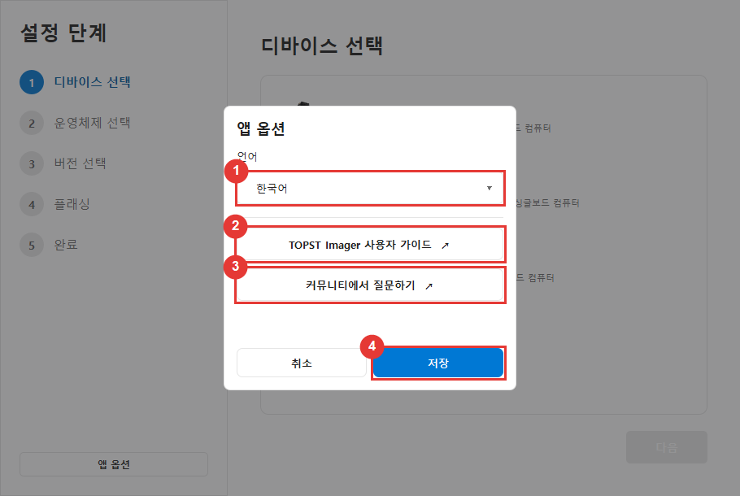
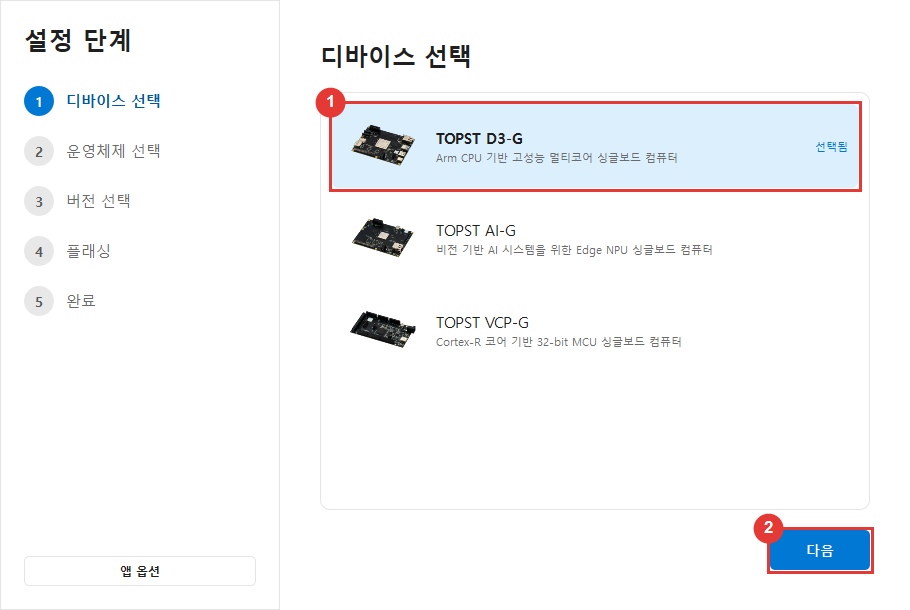
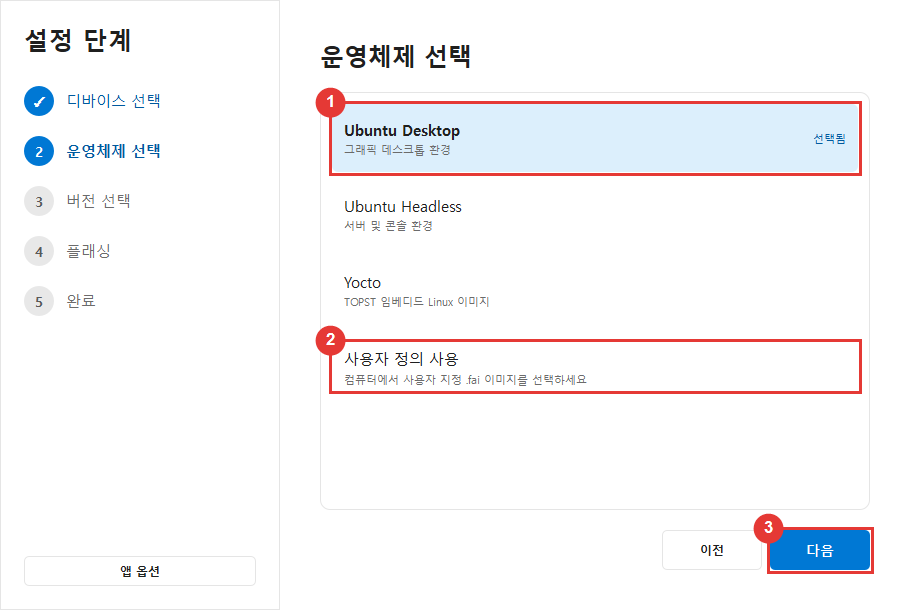
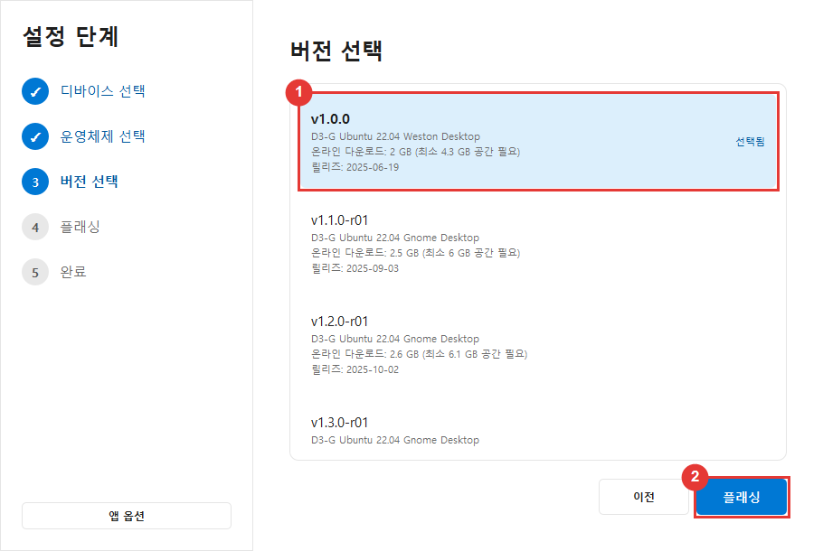
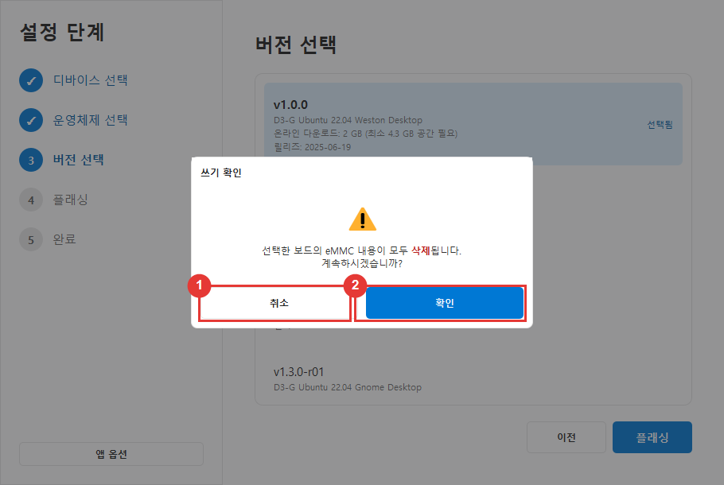
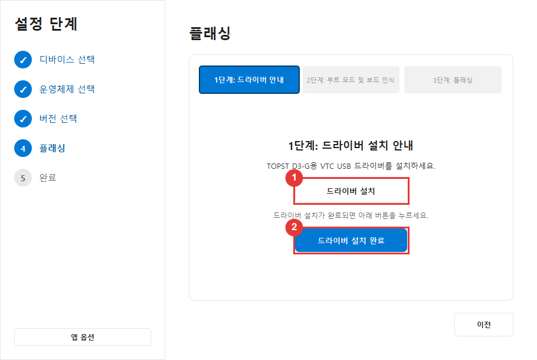
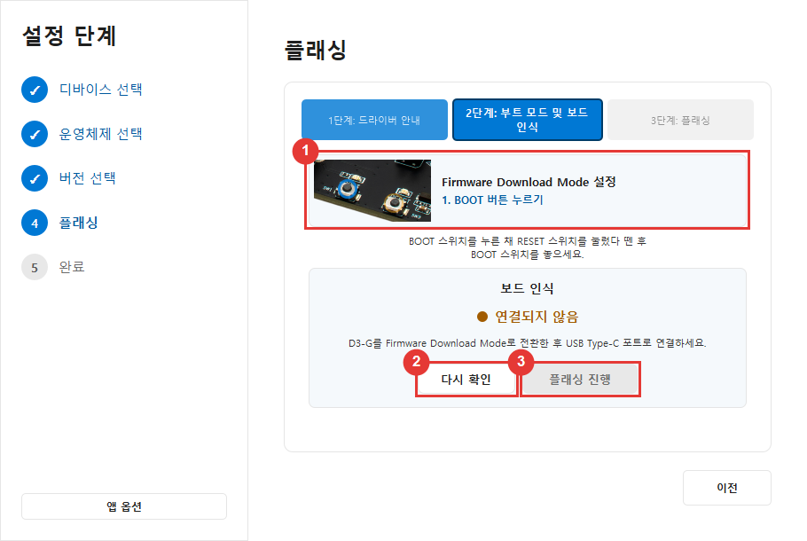
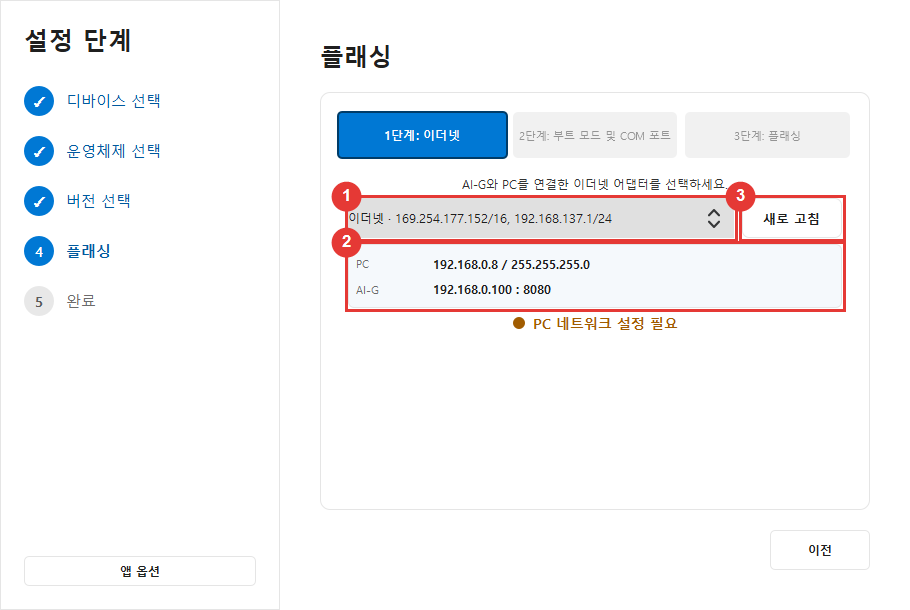
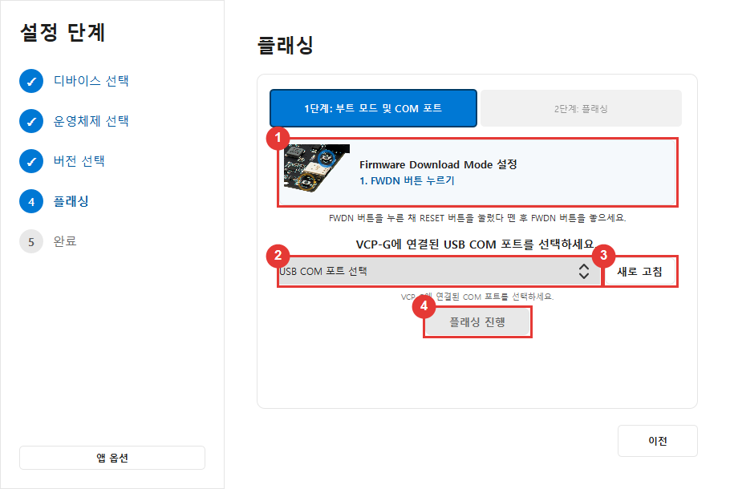
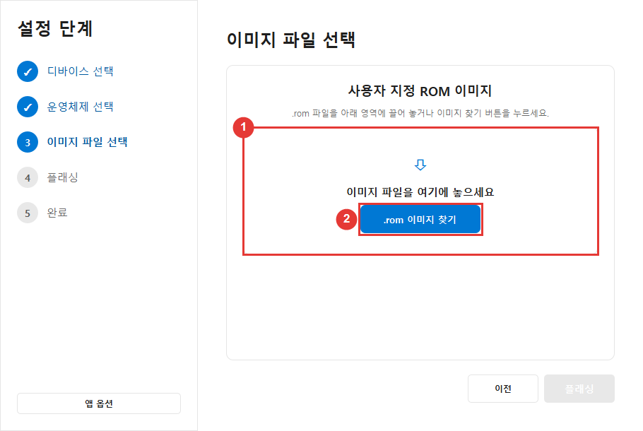

# TOPST Imager 사용자 가이드

TOPST Imager는 TOPST 보드에 운영체제 또는 펌웨어를 설치합니다. 프로그래밍이나 전자공학 지식은 필요하지 않습니다. 이 가이드를 열어 두고 화면을 하나씩 따라 진행하세요.

> **중요:** 플래싱하면 보드 eMMC에 저장된 모든 데이터가 삭제될 수 있습니다. 시작하기 전에 필요한 파일을 백업하세요.

> **스크린샷 안내:** 빨간 상자와 번호 원은 이 가이드를 위해 추가한 것으로 TOPST Imager에는 표시되지 않습니다. 스크린샷은 Windows의 밝은 테마를 사용하며, Linux와 어두운 테마에서도 사용 방법은 같습니다.

## 1. 화면에서 볼 수 있는 용어

| 용어 | 쉬운 설명 |
| --- | --- |
| Board / Device | 이미지를 설치할 TOPST 제품입니다. |
| Image | 운영체제 또는 펌웨어가 포함된 파일입니다. |
| Flashing | 선택한 이미지를 보드에 기록하는 작업입니다. |
| Firmware Download Mode / Boot Mode | 플래싱을 위한 보드의 특수 상태입니다. |
| FWDN | TOPST Imager가 백그라운드에서 실행하는 도구입니다. 직접 실행하지 않습니다. |
| COM port | AI-G와 VCP-G가 사용하는 USB 시리얼 연결입니다. Linux에서는 `/dev/ttyUSB...` 또는 `/dev/ttyACM...`으로 표시됩니다. |
| eMMC | 보드에 내장된 저장장치입니다. |

## 2. 지원 보드

| 보드 | 사용자 이미지 | 플래싱 시 사용하는 연결 |
| --- | --- | --- |
| TOPST D3-G | `.fai` | 보드 전원 및 FWDN USB Type-C 데이터 케이블 |
| TOPST AI-G | `.fai` | 보드 전원, FWDN USB Type-C 데이터 케이블 및 Ethernet 케이블 |
| TOPST VCP-G | `.rom` | 보드 전원 및 FWDN USB Type-C 데이터 케이블 |

**데이터 전송**을 지원하는 USB Type-C 케이블을 사용하세요. 충전 전용 케이블은 사용할 수 없습니다.

## 3. 시작 전 준비

- 사용할 TOPST 보드와 전원 어댑터
- USB Type-C 데이터 케이블
- AI-G 사용 시 Ethernet 케이블
- 공식 이미지 사용 시 인터넷에 연결된 컴퓨터
- 압축 파일 다운로드와 압축 해제된 패키지를 모두 저장할 충분한 디스크 공간
- 보드의 중요한 데이터 백업

플래싱 중에는 다음 사항을 지키세요.

- 보드나 컴퓨터의 전원을 끄지 마세요.
- USB 또는 Ethernet 케이블을 분리하지 마세요.
- TOPST Imager를 종료하지 마세요.
- 컴퓨터가 절전 모드로 전환되지 않도록 하세요.

## 4. 앱 옵션

메인 창 왼쪽 아래의 **앱 옵션**을 선택합니다.



1. **언어:** 언어를 선택하면 화면이 즉시 바뀌어 미리 확인할 수 있습니다.
2. **TOPST Imager 사용자 가이드:** 웹 브라우저에서 이 사용자 가이드를 엽니다.
3. **커뮤니티에서 질문하기:** [TOPST 커뮤니티](https://community.topst.ai/)를 엽니다.
4. **저장:** 선택한 언어를 저장합니다. **취소**, `Esc` 키 또는 창 바깥을 클릭하면 옵션 창을 열기 전의 언어로 돌아갑니다.

한국어, 영어, 일본어, 중국어 간체, 중국어 번체, 태국어, 독일어를 지원합니다. 밝은 테마와 어두운 테마는 운영체제 설정을 자동으로 따릅니다.

---

# Windows

## 1. TOPST Imager 설치

### 1.1 요구 사항

- Windows 10 64비트 이상
- Windows 11 64비트

### 1.2 설치

1. 공식 TOPST Imager Windows 설치 프로그램을 다운로드합니다.
2. 설치 프로그램을 두 번 클릭합니다.
3. 사용권 계약을 읽고 동의합니다.
4. **설치**를 선택합니다.
5. 설치가 완료되면 **TOPST Imager 바로 실행**을 선택합니다.

TOPST Imager 또는 VTC 드라이버 설치 프로그램을 시작할 때 Windows가 관리자 권한을 요청할 수 있습니다. 공식 TOPST 배포 파일인지 확인한 후 **예**를 선택하세요.

## 2. 보드, 운영체제 및 버전 선택

### 2.1 보드 선택



1. 실제 사용하는 제품과 일치하는 보드를 선택합니다.
2. 행이 강조되고 **선택됨**이 표시되는지 확인한 다음 **다음**을 선택합니다.

보드를 두 번 클릭해도 다음으로 이동할 수 있습니다. 잘못 선택했다면 **이전**으로 돌아가 다시 선택하세요.

### 2.2 운영체제 선택



1. TOPST가 제공하는 운영체제를 선택합니다.
2. 컴퓨터에 저장된 파일을 사용하려면 **사용자 정의 사용**을 선택합니다.
3. **다음**을 선택하거나 선택한 행을 두 번 클릭합니다.

### 2.3 버전 선택



1. 필요한 버전을 선택합니다. 설명, 출시일, 다운로드 크기와 압축 해제 크기를 확인합니다.
2. **플래싱**을 선택합니다.

- **온라인 다운로드**는 인터넷에서 전송되는 압축 파일의 크기입니다.
- **최소 필요 공간**은 압축 해제 후 필요한 대략적인 디스크 공간입니다.

프로젝트에서 특정 릴리스를 요구하지 않는다면 최신 안정 버전 또는 권장 버전을 사용하세요.

### 2.4 데이터 삭제 확인



1. 보드, 이미지 또는 백업을 다시 확인해야 한다면 **취소**를 선택합니다.
2. 선택한 보드의 eMMC 데이터가 삭제될 수 있음을 이해한 경우에만 **확인**을 선택합니다.

이 단계에서 **취소**를 선택하면 보드는 삭제되지 않습니다.

## 3. Windows에서 D3-G 플래싱

Windows의 D3-G 플래싱 설정은 3단계입니다.

### 1단계: VTC 드라이버 설치



1. **드라이버 설치**를 선택합니다.
2. Windows 관리자 권한 요청을 승인합니다.
3. VTC 드라이버 설치를 완료합니다.
4. TOPST Imager로 돌아옵니다.
5. **드라이버 설치 완료**를 선택합니다.

일반적으로 Windows 컴퓨터마다 한 번만 설치하면 됩니다. 관리자 권한 요청을 취소하면 드라이버가 설치되지 않습니다. 준비되면 **드라이버 설치**를 다시 선택하세요.

### 2단계: 부트 모드 진입 및 보드 감지



1. 부트 모드 애니메이션의 깜박이는 표시를 따릅니다.
2. **BOOT** 버튼을 길게 누릅니다.
3. **BOOT** 버튼을 누른 상태에서 **RESET** 버튼을 눌렀다 놓습니다.
4. **BOOT** 버튼을 놓습니다.
5. FWDN USB Type-C 데이터 케이블을 단단히 연결합니다.
6. 상태가 자동 갱신되지 않으면 **다시 확인**을 선택합니다.
7. 연결 상태로 바뀌면 **플래싱 진행**을 선택합니다.

Windows 장치 관리자의 범용 직렬 버스 컨트롤러 아래에 `Telechips TCCxxxx VTC USB Driver`와 비슷한 이름으로 표시될 수 있습니다.

### 3단계: 플래싱

공식 이미지는 다음 진행률을 각각 표시합니다.

1. 다운로드
2. 압축 해제
3. 플래싱

각 진행률은 0%에서 100%로 바뀝니다. **완료** 화면이 나타날 때까지 아무것도 분리하지 마세요.

## 4. Windows에서 AI-G 플래싱

AI-G 플래싱 설정은 3단계입니다.

### 1단계: Ethernet 설정



1. Ethernet 케이블로 컴퓨터와 AI-G를 직접 연결합니다.
2. Wi-Fi가 아닌 AI-G에 연결된 유선 Ethernet 어댑터를 선택합니다.
3. 요청이 표시되면 TOPST Imager가 임시 주소 `192.168.0.8/24`를 적용하도록 허용합니다.
4. 네트워크 상태가 준비되면 진행합니다.

작업이 완료되거나 취소되면 TOPST Imager가 임시 Windows 네트워크 설정을 원래대로 복원합니다.

### 2단계: 부트 모드 및 COM 포트

1. 화면의 부트 모드 애니메이션을 따릅니다.
2. **BOOT** 버튼을 길게 누릅니다.
3. **RESET** 버튼을 눌렀다 놓습니다.
4. **BOOT** 버튼을 놓습니다.
5. AI-G의 COM 포트를 선택합니다.
6. 보드 전원, USB Type-C 및 Ethernet 케이블을 확인합니다.
7. 플래싱으로 진행합니다.

COM 포트가 여러 개면 AI-G USB 케이블을 잠시 분리하세요. 사라지는 포트가 보통 AI-G 포트입니다. 다시 연결하고 부트 모드에 다시 진입한 후 해당 포트를 선택하세요.

### 3단계: 플래싱

진행률이 100%가 되고 **완료** 화면이 나타날 때까지 기다립니다.

## 5. Windows에서 VCP-G 플래싱

VCP-G 플래싱 설정은 2단계입니다.

### 1단계: 부트 모드 및 COM 포트



부트 모드 안내와 COM 포트 선택은 같은 화면에 있습니다.

1. 보드 애니메이션에 따라 VCP-G를 Firmware Download Mode로 전환합니다.
2. 안내에 따라 **RESET** 버튼을 눌렀다 놓습니다.
3. VCP-G의 COM 포트를 선택합니다.
4. 보드 전원과 FWDN USB Type-C 데이터 케이블을 다시 확인합니다.
5. 플래싱으로 진행합니다.

### 2단계: 플래싱

진행률이 100%가 되고 **완료** 화면이 나타날 때까지 기다립니다.

## 6. Windows에서 사용자 이미지 사용

**D3-G / AI-G (.fai)**


**VCP-G (.rom)**



1. 먼저 올바른 보드를 선택합니다.
2. 운영체제 화면에서 **사용자 정의 사용**을 한 번 클릭합니다.
3. **다음**을 선택하거나 **사용자 정의 사용**을 두 번 클릭합니다.
4. 파일을 드롭 영역으로 끌어 놓거나 파일 찾기 버튼을 선택합니다.
5. 선택한 파일 이름을 확인하고 진행합니다.

올바른 파일 형식을 사용하세요.

- D3-G: `.fai`
- AI-G: `.fai`
- VCP-G: `.rom`

사용자 이미지는 컴퓨터에 이미 있으므로 **다운로드**와 **압축 해제** 진행률 행이 숨겨집니다. 보드별 드라이버, 네트워크, 부트 모드, COM 포트 및 플래싱 절차는 동일하게 적용됩니다.

---

# Linux

## 1. Linux 요구 사항

현재 Linux 배포판은 **x86_64 Linux**를 지원합니다. Windows `.exe` FWDN 파일은 Linux에서 사용할 수 없습니다.

배포 앱에 다음 Linux 실행 도구가 포함되어 있어야 합니다.

```text
tools/fwdn_d3/fwdn_d3
tools/fwdn_ai/fwdn_ai
tools/fwdn_vcp/fwdn_vcp
```

컴퓨터에는 다음 도구도 필요합니다.

- 공식 ZIP 패키지를 위한 `unzip`
- 관리자 확인 창을 위한 `policykit-1`
- AI-G 및 VCP-G 시리얼 포트 임시 접근을 위한 `acl`

Ubuntu에서 관리자는 다음 명령으로 설치할 수 있습니다.

```bash
sudo apt update
sudo apt install unzip policykit-1 acl
```

TOPST Imager 또는 FWDN을 `sudo`로 실행하지 **마세요**. TOPST Imager는 선택한 시리얼 장치에 임시 접근 권한이 필요할 때만 관리자 권한을 요청합니다.

## 2. Linux 패키지 설치 및 실행

정확한 압축 파일 이름은 릴리스마다 다를 수 있습니다. `.tar.gz` 패키지의 예:

```bash
cd ~/Downloads
tar -xzf TOPST-Imager-<version>-Linux-x86_64.tar.gz
cd TOPST-Imager-<version>-Linux-x86_64
chmod +x topst-imager
./topst-imager
```

다운로드한 패키지의 실제 파일 및 폴더 이름을 사용하세요. 사용자용 패키지에는 Qt 런타임이 포함되어 있어야 합니다. Qt 라이브러리가 없다면 root로 실행하지 말고 완전한 공식 Linux 패키지를 다운로드하세요.

## 3. Linux에서 이미지 선택

보드, 운영체제, 버전, 사용자 이미지 및 eMMC 경고 화면은 2절과 6절의 Windows 화면과 동일하게 동작합니다.

## 4. Linux에서 D3-G 플래싱

Windows VTC 드라이버 설치 화면이 없으므로 Linux의 D3-G 플래싱 설정은 2단계입니다.

### 1단계: 부트 모드 및 보드 감지

1. **BOOT** 버튼을 길게 누릅니다.
2. **RESET** 버튼을 눌렀다 놓습니다.
3. **BOOT** 버튼을 놓습니다.
4. FWDN USB Type-C 데이터 케이블을 연결합니다.
5. 필요하면 **다시 확인**을 선택합니다.
6. D3-G가 감지되면 진행합니다.

Linux는 D3-G FWDN USB 장치를 직접 감지합니다. 감지되지 않으면 USB 데이터 케이블, 보드 전원, 부트 모드 및 Linux 패키지와 함께 제공되어 설치된 udev 규칙을 확인하세요.

### 2단계: 플래싱

다운로드, 압축 해제 및 플래싱이 완료될 때까지 기다립니다. 사용자 `.fai` 이미지는 플래싱 진행률만 표시합니다.

## 5. Linux에서 AI-G 플래싱

AI-G 플래싱 설정은 3단계입니다.

### 1단계: Ethernet 설정

TOPST Imager는 Linux Ethernet 주소를 자동 변경하지 않습니다. Linux 네트워크 설정에서 지정하세요.

1. **설정 → 네트워크**를 엽니다.
2. AI-G에 연결된 유선 연결을 엽니다.
3. IPv4를 **수동**으로 설정합니다.
4. 주소: `192.168.0.8`
5. 넷마스크: `255.255.255.0` 또는 접두사 길이 `24`
6. 네트워크 관리자의 별도 안내가 없다면 게이트웨이와 DNS는 비워 둡니다.
7. 변경을 적용하고 유선 연결을 다시 연결한 다음 TOPST Imager로 돌아옵니다.

### 2단계: 부트 모드, COM 포트 및 임시 접근

1. 부트 모드 애니메이션을 따릅니다.
2. `/dev/ttyUSB0`과 같은 AI-G 포트를 선택합니다.
3. 포트에 쓰기 권한이 없다면 **임시 권한 설정**을 선택합니다.
4. Linux 관리자 창에서 승인합니다.
5. 접근 권한이 준비되면 플래싱 버튼을 사용할 수 있습니다.

임시 접근 권한은 선택한 시리얼 장치에만 적용되며 플래싱, 취소 또는 플래싱 화면을 벗어난 후 해제됩니다. 사용자를 `dialout` 그룹에 영구적으로 추가할 필요가 없습니다.

### 3단계: 플래싱

**완료** 화면이 나타날 때까지 기다립니다.

## 6. Linux에서 VCP-G 플래싱

Windows와 마찬가지로 Linux의 VCP-G 플래싱 설정은 2단계입니다.

### 1단계: 부트 모드, COM 포트 및 임시 접근

1. 부트 모드 안내를 따릅니다.
2. `/dev/ttyUSB0`과 같은 VCP-G 포트를 선택합니다.
3. 표시된다면 **임시 권한 설정**을 선택하고 관리자 창에서 승인합니다.
4. 선택한 포트에 접근할 수 있게 되면 진행합니다.

### 2단계: 플래싱

진행률이 100%가 되고 **완료** 화면이 나타날 때까지 기다립니다. 사용자 `.rom` 이미지는 플래싱 진행률만 표시합니다.

## 7. 다운로드, 재시도 및 임시 파일

공식 이미지를 사용하면 TOPST Imager는 다음과 같이 동작합니다.

1. 임시 작업 폴더를 생성합니다.
2. ZIP 패키지를 다운로드합니다.
3. 임시 폴더에 패키지를 압축 해제합니다.
4. 보드별 FWDN 실행 파일을 실행합니다.
5. 플래싱 성공 또는 취소 후 다운로드 및 압축 해제된 임시 데이터를 삭제합니다.

다운로드 중 인터넷이 끊기면 TOPST Imager를 열어 둔 채 네트워크를 다시 연결하세요. 서버가 지원하면 자동으로 재시도하고 부분 다운로드부터 이어받습니다. 상태는 선택한 앱 언어로 표시됩니다.

복구 가능한 일부 플래싱 오류에서는 준비된 패키지를 임시로 유지하므로 다시 다운로드하지 않고 안내된 설정 단계로 돌아갈 수 있습니다.

## 8. 오류 창이 나타날 때

TOPST Imager는 알려진 FWDN 오류를 감지하면 즉시 오류 창을 엽니다. 3초 카운트다운이 표시되면 메시지를 읽으세요. 카운트다운 후 앱이 필요한 복구 단계로 돌아갑니다. 나열된 항목을 확인하고 **확인**을 선택하세요.

### D3-G 연결 오류

다음을 확인하세요.

1. 보드 전원 연결
2. FWDN USB Type-C 케이블 연결
3. Firmware Download Mode 진입

앱은 D3-G 부트 모드 단계로 돌아갑니다.

### AI-G 연결 또는 동기화 오류

다음을 확인하세요.

1. 보드 전원 연결
2. Firmware Download Mode 진입
3. 올바른 COM 포트 선택

`Failed open port` 메시지라면 FWDN USB Type-C 케이블과 선택한 포트를 확인하세요. `TCP Socket Open Fail`이라면 Ethernet 케이블, 어댑터 및 `192.168.0.8/24` 네트워크 설정을 확인하세요.

### VCP-G 연결 오류

다음을 확인하세요.

1. 보드 전원 연결
2. Firmware Download Mode 진입
3. 올바른 COM 포트 선택

`GetLastError : 22`가 나타나면 FWDN USB Type-C 케이블 연결을 확인하세요.

### COM 포트가 표시되지 않음

1. 보드 전원을 확인합니다.
2. USB 데이터 케이블을 다시 연결합니다.
3. Firmware Download Mode 진입을 반복합니다.
4. 포트 목록을 새로 고칩니다.
5. Linux에서는 포트 선택 후 **임시 권한 설정**을 선택합니다.

### 플래싱이 완전히 실패함

`Failed to write in eFlash` 또는 `Failed FWDN` 오류라면 메시지에 따라 첫 번째 플래싱 설정 단계부터 다시 시작하세요. 기록 작업이 진행 중일 때는 보드를 분리하지 마세요.

## 9. 로그 파일

도움을 요청할 때는 전체 오류 메시지, 보드 이름, 선택한 이미지 버전, 운영체제 및 로그 파일을 함께 제공하세요.

Windows 로그 경로:

```text
%LOCALAPPDATA%\Telechips\TOPST Imager\logs\topst-imager.log
```

일반적인 Linux 로그 경로:

```text
~/.local/share/Telechips/TOPST Imager/logs/topst-imager.log
```

추가 도움이 필요하면 **앱 옵션 → 커뮤니티에서 질문하기**를 사용하거나 [TOPST 커뮤니티](https://community.topst.ai/)를 방문하세요.

## 10. 플래싱 완료 후

1. **완료** 화면이 보이는지 확인합니다.
2. TOPST Imager가 작업 완료를 알릴 때까지 기다립니다.
3. 보드 전원을 안전하게 끕니다.
4. FWDN 케이블을 분리하거나 일반 사용에 맞게 케이블을 다시 연결합니다.
5. 보드를 켜고 새 운영체제가 시작되는지 확인합니다.

다음 세 가지를 기억하세요.

1. 보드와 이미지를 신중하게 선택하세요.
2. 플래싱 중에는 전원이나 케이블을 절대 분리하지 마세요.
3. 오류가 나면 나열된 모든 항목을 위에서부터 확인하세요.
