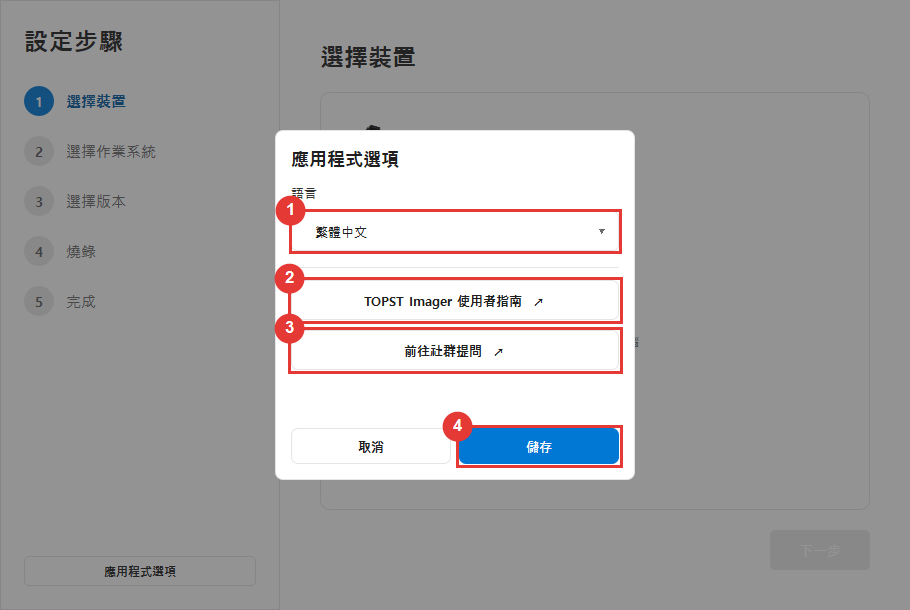
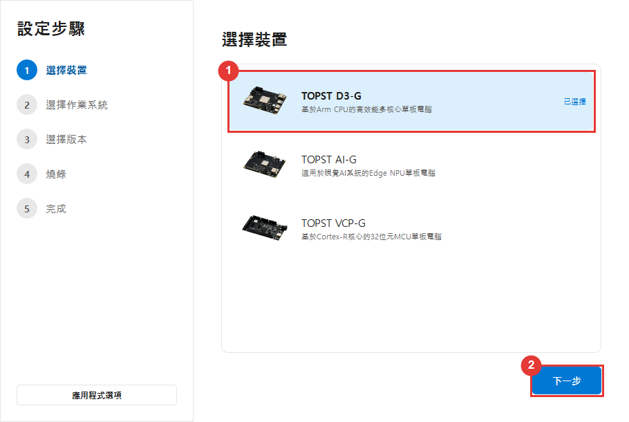
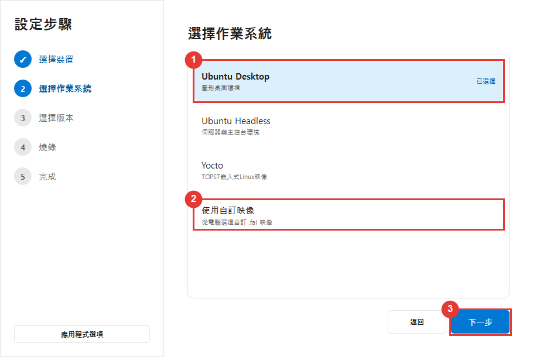
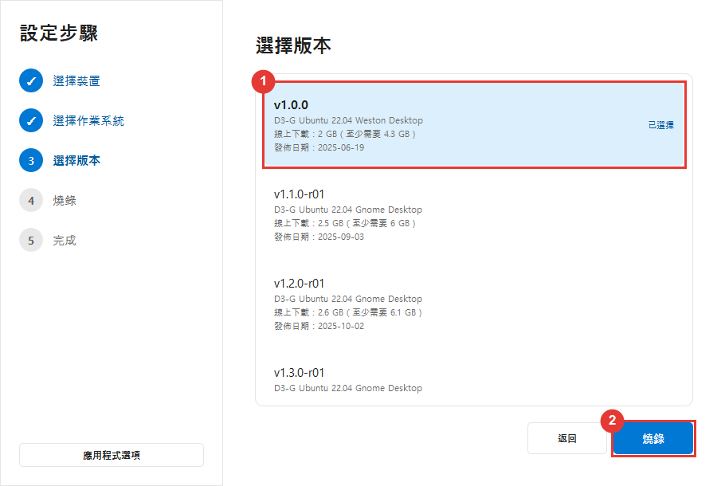
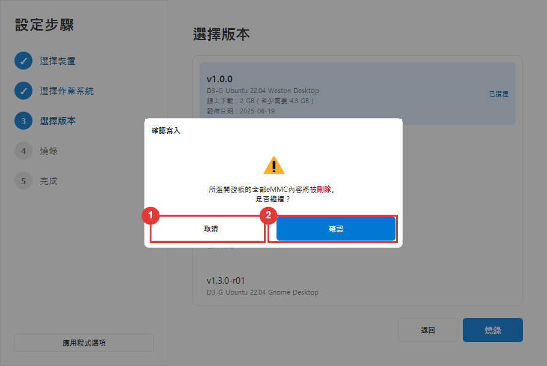
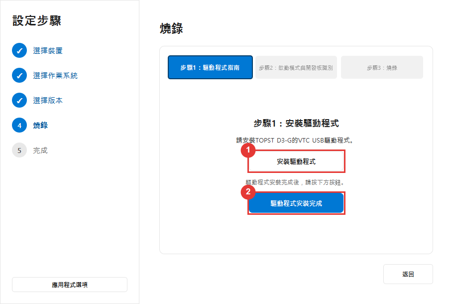
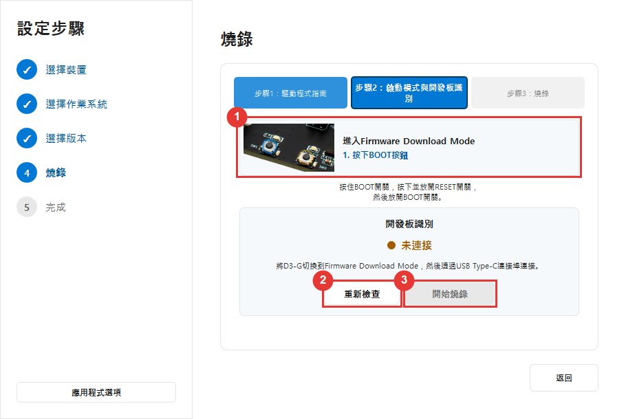
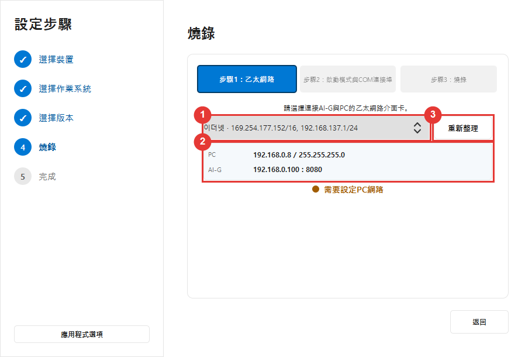
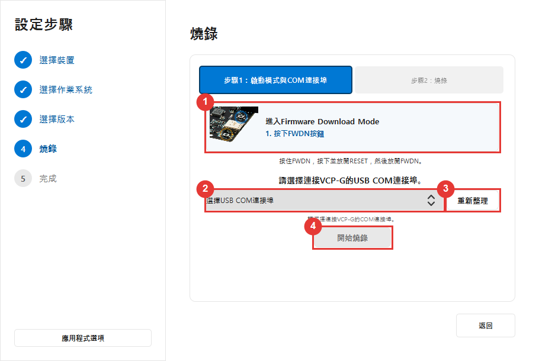
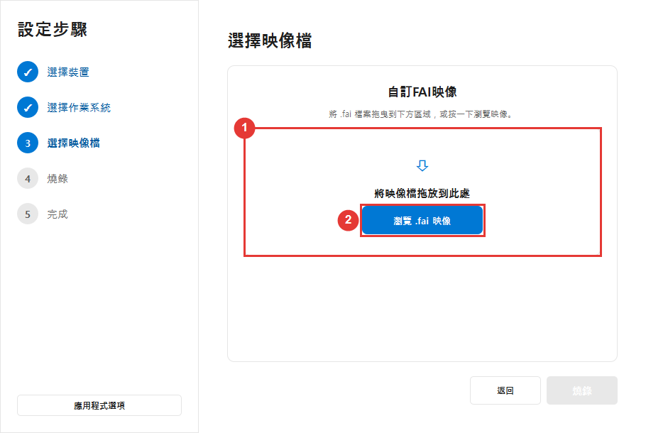

# TOPST Imager 使用者指南

TOPST Imager 用於在 TOPST 開發板上安裝作業系統或韌體。不需要程式設計或電子知識。請保持本指南開啟，逐一依畫面操作。

> **重要：** 燒錄可能會清除開發板 eMMC 中的所有內容。開始前請備份所需檔案。

> **關於畫面擷取：** 紅框和帶數字的圓圈僅為本指南加入，不會在 TOPST Imager 中顯示。圖片使用 Windows 淺色佈景主題；Linux 和深色主題的操作方式相同。

## 1. 畫面中的術語

| 術語 | 簡單說明 |
| --- | --- |
| Board / Device | 要安裝映像檔的 TOPST 產品。 |
| Image | 包含作業系統或韌體的檔案。 |
| Flashing | 將所選映像檔寫入開發板。 |
| Firmware Download Mode / Boot Mode | 用於燒錄的特殊開發板狀態。 |
| FWDN | TOPST Imager 在背景執行的工具，不需要自行啟動。 |
| COM port | AI-G 和 VCP-G 使用的 USB 序列連線。Linux 顯示為 `/dev/ttyUSB...` 或 `/dev/ttyACM...`。 |
| eMMC | 開發板內建儲存裝置。 |

## 2. 支援的開發板

| 開發板 | 自訂映像檔 | 燒錄時使用的連線 |
| --- | --- | --- |
| TOPST D3-G | `.fai` | 開發板電源與 FWDN USB Type-C 資料傳輸線 |
| TOPST AI-G | `.fai` | 開發板電源、FWDN USB Type-C 資料傳輸線與乙太網路線 |
| TOPST VCP-G | `.rom` | 開發板電源與 FWDN USB Type-C 資料傳輸線 |

請使用支援**資料傳輸**的 USB Type-C 線。僅供充電的線材無法使用。

## 3. 開始前準備

- 正確的 TOPST 開發板與電源供應器
- USB Type-C 資料傳輸線
- 使用 AI-G 時的乙太網路線
- 使用官方映像檔時可連接網際網路的電腦
- 能同時存放下載壓縮檔與解壓縮套件的足夠磁碟空間
- 開發板上重要資料的備份

燒錄期間：

- 不要關閉開發板或電腦。
- 不要拔除 USB 或乙太網路線。
- 不要關閉 TOPST Imager。
- 不要讓電腦進入睡眠。

## 4. 應用程式選項

選取主視窗左下角的 **應用程式選項**。



1. **語言：** 選取語言後立即切換畫面，以便預覽。
2. **TOPST Imager 使用者指南：** 在瀏覽器中開啟本使用者指南。
3. **前往社群提問：** 開啟 [TOPST 社群](https://community.topst.ai/)。
4. **儲存：** 儲存所選語言。選取 **取消**、按 `Esc` 或點選視窗外部，會恢復開啟視窗前的語言。

支援韓文、英文、日文、簡體中文、繁體中文、泰文與德文。淺色或深色外觀自動跟隨作業系統佈景主題。

---

# Windows

## 1. 安裝 TOPST Imager

### 1.1 系統需求

- Windows 10 64 位元或更新版本
- Windows 11 64 位元

### 1.2 安裝

安裝程式支援韓文與英文。下方 **Install** 與 **Launch TOPST Imager now** 是英文安裝程式中的文字。

1. 下載官方 TOPST Imager Windows 安裝程式。
2. 按兩下安裝程式。
3. 閱讀並接受授權合約。
4. 選取 **Install**。
5. 完成後選取 **Launch TOPST Imager now**。

啟動應用程式或 VTC 驅動程式安裝精靈時，Windows 可能要求管理員權限。確認檔案來自官方 TOPST 發行套件後，再選取 **是**。

## 2. 選取開發板、作業系統與版本

### 2.1 選取開發板



1. 選取與手邊產品一致的開發板。
2. 確認該列反白並顯示 **已選擇**，再選取 **下一步**。

也可按兩下開發板繼續。選錯時選取 **返回** 返回重選。

### 2.2 選取作業系統



1. 選取 TOPST 提供的作業系統。
2. 使用電腦中的檔案時選取 **使用自訂映像**。
3. 選取 **下一步** 或按兩下所選列。

### 2.3 選取版本



1. 選取所需版本，檢查說明、發行日期、下載大小與解壓縮大小。
2. 選取 **燒錄**。

- **線上下載** 是從網際網路傳輸的壓縮檔大小。
- **最低所需空間** 是解壓縮後預計所需的磁碟空間。

除非專案要求特定版本，否則使用最新穩定版或建議版本。

### 2.4 確認清除資料



1. 需要重新檢查開發板、映像檔或備份時，選取 **取消**。
2. 只有瞭解所選開發板的 eMMC 資料可能被刪除後，才選取 **確認**。

此時選取 **取消** 不會清除開發板。

## 3. 在 Windows 上燒錄 D3-G

Windows 上的 D3-G 燒錄設定分為三步。

### 步驟 1：安裝 VTC 驅動程式



1. 選取 **安裝驅動程式**。
2. 核准 Windows 管理員要求。
3. 完成 VTC 驅動程式安裝。
4. 返回 TOPST Imager。
5. 選取 **驅動程式安裝完成**。

通常每部 Windows 電腦只需安裝一次。取消管理員要求就不會安裝驅動程式；準備好後再次選取 **安裝驅動程式**。

### 步驟 2：進入開機模式並偵測開發板



1. 按開機模式動畫的閃爍標記操作。
2. 按住 **BOOT** 按鈕。
3. 按住 **BOOT** 按鈕 時按下並放開 **RESET** 按鈕。
4. 放開 **BOOT** 按鈕。
5. 牢固連接 FWDN USB Type-C 資料傳輸線。
6. 狀態未自動更新時選取 **重新檢查**。
7. 狀態變為已連接後選取 **開始燒錄**。

Windows 裝置管理員的通用序列匯流排控制器下，可能顯示類似 `Telechips TCCxxxx VTC USB Driver` 的名稱。

### 步驟 3：燒錄

官方映像檔分別顯示以下進度：

1. 下載
2. 解壓縮
3. 燒錄

各項進度從 0% 到 100%。請等待 **完成** 畫面後再中斷連線。

## 4. 在 Windows 上燒錄 AI-G

AI-G 燒錄設定分為三步。

### 步驟 1：設定乙太網路



1. 用乙太網路線直接連接電腦與 AI-G。
2. 選取連接 AI-G 的有線介面卡，而非 Wi-Fi。
3. 出現提示時允許應用程式設定暫時位址 `192.168.0.8/24`。
4. 網路就緒後繼續。

操作完成或取消後，TOPST Imager 會還原暫時變更的 Windows 網路設定。

### 步驟 2：開機模式與 COM 連接埠

1. 按畫面開機模式動畫操作。
2. 按住 **BOOT** 按鈕。
3. 按下並放開 **RESET** 按鈕。
4. 放開 **BOOT** 按鈕。
5. 選取 AI-G 的 COM 連接埠。
6. 檢查電源、USB Type-C 資料傳輸線與乙太網路線。
7. 繼續燒錄。

有多個 COM 連接埠時，可暫時拔下 AI-G USB 線。消失的通常屬於 AI-G。重新連接、再次進入開機模式，再選取該連接埠。

### 步驟 3：燒錄

等待達到 100% 並出現 **完成** 畫面。

## 5. 在 Windows 上燒錄 VCP-G

VCP-G 燒錄設定分為兩步。

### 步驟 1：開機模式與 COM 連接埠



開機模式指南與 COM 連接埠選取在同一畫面。

1. 按動畫將 VCP-G 設為 Firmware Download Mode。
2. 按指南要求按下並放開 **RESET** 按鈕。
3. 選取 VCP-G 的 COM 連接埠。
4. 再次檢查電源與 FWDN USB Type-C 資料傳輸線。
5. 繼續燒錄。

### 步驟 2：燒錄

等待達到 100% 並出現 **完成** 畫面。

## 6. 在 Windows 上使用自訂映像檔

**D3-G / AI-G (.fai)**



**VCP-G (.rom)**


1. 先選取正確的開發板。
2. 在作業系統畫面按一下 **使用自訂映像**。
3. 選取 **下一步** 或按兩下 **使用自訂映像**。
4. 將檔案拖入放置區域，或選取瀏覽按鈕。
5. 檢查檔名後繼續。

使用正確格式：

- D3-G: `.fai`
- AI-G: `.fai`
- VCP-G: `.rom`

檔案已在本機，因此 **下載** 和 **解壓縮** 進度列會隱藏。對應開發板的驅動程式、網路、開機模式、COM 連接埠與燒錄步驟仍適用。

---

# Linux

## 1. Linux 需求

目前發行套件支援 **x86_64 Linux**。Windows `.exe` FWDN 檔案不能在 Linux 使用。

發行應用程式必須包含以下 Linux 執行工具：

```text
tools/fwdn_d3/fwdn_d3
tools/fwdn_ai/fwdn_ai
tools/fwdn_vcp/fwdn_vcp
```

電腦還需要：

- 用於官方 ZIP 套件的 `unzip`
- 用於管理員確認視窗的 `policykit-1`
- 用於 AI-G 和 VCP-G 暫時序列埠存取的 `acl`

Ubuntu 管理員可執行：

```bash
sudo apt update
sudo apt install unzip policykit-1 acl
```

**不要**用 `sudo` 執行 TOPST Imager 或 FWDN。應用程式僅在需要授予所選序列裝置暫時存取權限時要求管理員權限。

## 2. 安裝並啟動 Linux 套件

壓縮檔名可能隨版本變更。`.tar.gz` 套件範例：

```bash
cd ~/Downloads
tar -xzf TOPST-Imager-<version>-Linux-x86_64.tar.gz
cd TOPST-Imager-<version>-Linux-x86_64
chmod +x topst-imager
./topst-imager
```

請使用下載套件的實際檔案與資料夾名稱。使用者套件應包含 Qt 執行階段；若缺少 Qt 程式庫，請下載完整官方 Linux 套件，而不要以 root 執行。

## 3. 在 Linux 上選取映像檔

開發板、作業系統、版本、自訂映像檔與 eMMC 警告畫面，與第 2 節和第 6 節的 Windows 畫面相同。

## 4. 在 Linux 上燒錄 D3-G

不顯示 Windows VTC 驅動程式安裝步驟，因此 Linux 上分為兩步。

### 步驟 1：開機模式與開發板偵測

1. 按住 **BOOT** 按鈕。
2. 按下並放開 **RESET** 按鈕。
3. 放開 **BOOT** 按鈕。
4. 連接 FWDN USB Type-C 資料傳輸線。
5. 必要時選取 **重新檢查**。
6. 偵測到 D3-G 後繼續。

Linux 直接偵測 D3-G FWDN USB 裝置。未偵測到時，請檢查資料傳輸線、電源、開機模式，以及 Linux 套件提供且已安裝的 udev 規則。

### 步驟 2：燒錄

等待下載、解壓縮與燒錄完成。自訂 `.fai` 映像檔僅顯示燒錄進度。

## 5. 在 Linux 上燒錄 AI-G

AI-G 燒錄設定分為三步。

### 步驟 1：設定乙太網路

Linux 乙太網路位址不會自動變更，請在網路設定中指定：

1. 開啟 **設定 → 網路**。
2. 開啟連接 AI-G 的有線連線。
3. 將 IPv4 設為**手動**。
4. 位址：`192.168.0.8`
5. 子網路遮罩：`255.255.255.0`，或前綴長度 `24`
6. 除非網路管理員另有要求，否則閘道與 DNS 留空。
7. 套用變更，重新連接有線網路，返回 TOPST Imager。

### 步驟 2：開機模式、COM 連接埠與暫時存取

1. 按開機模式動畫操作。
2. 選取 AI-G 連接埠，例如 `/dev/ttyUSB0`。
3. 連接埠無法寫入時選取 **授予暫時權限**。
4. 核准 Linux 管理員視窗。
5. 權限就緒後燒錄按鈕可用。

暫時權限僅作用於所選序列裝置，在燒錄後、取消後或離開燒錄畫面後釋放。不需要將使用者永久加入 `dialout` 群組。

### 步驟 3：燒錄

等待 **完成** 畫面。

## 6. 在 Linux 上燒錄 VCP-G

與 Windows 一樣，燒錄設定分為兩步。

### 步驟 1：開機模式、COM 連接埠與暫時存取

1. 按開機模式指南操作。
2. 選取 VCP-G 連接埠，例如 `/dev/ttyUSB0`。
3. 若顯示 **授予暫時權限**，請選取並核准管理員視窗。
4. 所選連接埠可存取後繼續。

### 步驟 2：燒錄

等待達到 100% 並出現 **完成** 畫面。自訂 `.rom` 映像檔僅顯示燒錄進度。

## 7. 下載、重試與暫存檔案

使用官方映像檔時，應用程式會：

1. 建立暫存工作資料夾。
2. 下載 ZIP 套件。
3. 解壓縮至暫存資料夾。
4. 執行對應開發板的 FWDN 執行檔。
5. 燒錄成功或取消後刪除下載與解壓縮的暫存資料。

下載時斷線，請保持應用程式開啟並重新連網。應用程式會自動重試，伺服器支援時從部分下載處續傳。狀態以所選應用程式語言顯示。

某些可復原的燒錄錯誤會暫時保留準備好的套件，方便返回指定設定步驟而不必重新下載。

## 8. 出現錯誤視窗時

偵測到已知 FWDN 錯誤後會立即開啟錯誤視窗。若顯示三秒倒數，請閱讀訊息；倒數後返回所需復原步驟。檢查所列項目後選取 **確認**。

### D3-G 連線錯誤

檢查：

1. 開發板電源連接
2. FWDN USB Type-C 資料傳輸線連接
3. 是否進入 Firmware Download Mode

應用程式返回 D3-G 開機模式步驟。

### AI-G 連線或同步錯誤

檢查：

1. 開發板電源連接
2. 是否進入 Firmware Download Mode
3. COM 連接埠選取是否正確

若訊息為 `Failed open port`，檢查 FWDN USB Type-C 資料傳輸線與所選連接埠。若為 `TCP Socket Open Fail`，檢查乙太網路線、介面卡與 `192.168.0.8/24` 設定。

### VCP-G 連線錯誤

檢查：

1. 開發板電源連接
2. 是否進入 Firmware Download Mode
3. COM 連接埠選取是否正確

出現 `GetLastError : 22` 時，檢查 FWDN USB Type-C 連接。

### 沒有 COM 連接埠

1. 檢查電源。
2. 重新連接 USB 資料傳輸線。
3. 再次進入 Firmware Download Mode。
4. 重新整理連接埠清單。
5. Linux 上選取連接埠後選取 **授予暫時權限**。

### 燒錄完全失敗

若錯誤為 `Failed to write in eFlash` 或 `Failed FWDN`，請按訊息從第一個燒錄設定步驟重新開始。寫入仍在進行時不要中斷開發板連線。

## 9. 記錄檔

求助時提供完整錯誤訊息、開發板名稱、所選映像檔版本、作業系統與記錄檔。

Windows 記錄檔位置：

```text
%LOCALAPPDATA%\Telechips\TOPST Imager\logs\topst-imager.log
```

常見 Linux 記錄檔位置：

```text
~/.local/share/Telechips/TOPST Imager/logs/topst-imager.log
```

需要更多協助時，使用 **應用程式選項 → 前往社群提問** 或造訪 [TOPST 社群](https://community.topst.ai/)。

## 10. 燒錄完成後

1. 確認 **完成** 畫面可見。
2. 等待應用程式說明操作已完成。
3. 安全關閉開發板電源。
4. 拔除 FWDN 線，或還原正常使用的接線。
5. 開機並檢查新作業系統是否啟動。

記住三條規則：

1. 仔細選取開發板與映像檔。
2. 燒錄時絕不拔線或斷電。
3. 出現錯誤時，從上到下檢查所有列出項目。
